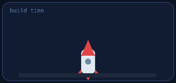
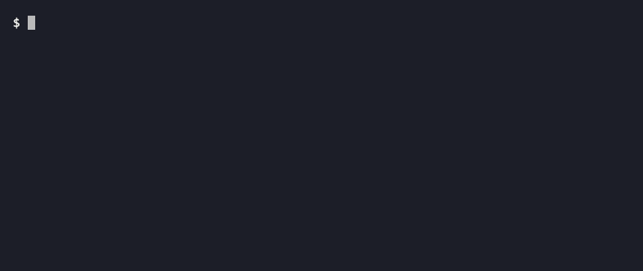

<p align="center"></p>

| | |
|-|-|
| **Time** | 75-90 min |
| **Cost** | free |
| **You need** | Docker running on your machine, git, a terminal and about 2 GB of free disk |

## How this lab works

1. **Fork** this repository to your own GitHub account (button at the top right).
2. Clone **your fork** in your Ubuntu environment (WSL on Windows, your OrbStack machine on Mac).
3. Read the lab below (the same text is in [`LAB.md`](LAB.md)) and follow the mission.
4. Answer the questions in [`SUBMISSION.md`](SUBMISSION.md). Where a question asks for output, paste it in a code block. No screenshots needed.
5. Commit and push. Open the **Actions** tab of your fork (click *I understand my workflows, go ahead and enable them* the first time). The **Lab check** shows what is still missing.
6. When the check is green, **submit the URL of your fork** in the course platform.

> [!NOTE]
> The check only looks at your answers and any files the lab asks you to commit. Your instructor reads your work and may ask you to explain any line.

<p align="center"></p>

## 🎬 The situation

<p align="center"></p>

Monday morning. The team wants Pollie, the polls application, running in containers by the end of the week. Someone already wrote a first `Dockerfile` ("it works on my machine") and nobody is happy:

- the image is more than a gigabyte
- every tiny code change makes CI wait for a full dependency install
- a security reviewer found the app runs as **root**
- nobody knows if the container is healthy until a user complains

You will measure the problem, then write the Dockerfile that fixes all four, and prove it by running the whole thing for real: the API, the worker and a vote travelling through Redis into PostgreSQL.

> [!IMPORTANT]
> **Your mission**
> - Build the naive image and **measure** what is wrong with it
> - Write a production `Dockerfile` that is small, cache-friendly, unprivileged and self-checking
> - Run the API **and** the worker from one image against a real database and queue
> - Break a dependency on purpose and watch what the health endpoints say
> - Tear everything down and prove it

**Time:** 75-90 min | **Cost:** free (about 2 GB of disk for images) | **You need:** Docker running, git, a terminal. `./teardown.sh` removes the lab.

<p align="center"></p>

## Part 0 - Set the scene

Fork this repository, clone your fork, and run:

```bash
./setup.sh
```

It clones the Pollie source into `./pollie` (do not edit it, you are packaging it), pulls the base images, and starts two containers for your image to talk to: `ship-db` (PostgreSQL) and `ship-redis` (Redis), on a Docker network called `ship-net`. `lab.env` holds the settings the containers need.

<p align="center"></p>

## Part 1 - Recon: how does Pollie start?

<p align="center"></p>

Before you write a Dockerfile you must know how the application runs. Read `pollie/README.md` and `pollie/requirements.txt`, then answer for yourself:

1. Which Python versions does it support? Which file lists the dependencies?
2. Which command starts the API, on which port? Which command starts the worker, and on which port does *it* serve health?
3. Which environment variables are required? (They are in `lab.env`.)
4. Which files does the application need at runtime? Which ones (tests, docs, git history) does it **not** need in an image?

<p align="center"></p>

## Part 2 - Measure the naive image

```bash
docker build -f naive/Dockerfile -t pollie:naive pollie
docker images pollie:naive
docker history pollie:naive
docker run --rm --entrypoint id pollie:naive
```

> [!NOTE]
> **Predict** Before you run the next steps: how big do you think the image is? Which user does it run as? If you change one line in `pollie/pollie/api/main.py` and build again, will `pip install` run again?

Now make that last experiment real:

```bash
echo "# change" >> pollie/pollie/api/main.py
time docker build -f naive/Dockerfile -t pollie:naive pollie
```

Watch which steps say `CACHED` and which do not. Undo the change with `git -C pollie checkout .`.

Read `docker history`: which layers are the biggest? What is in them?

<p align="center"></p>

## Part 3 - Write the production Dockerfile

Write `Dockerfile` in the root of this repository. The build context is `./pollie`:

```bash
docker build -f Dockerfile -t pollie:v1 pollie
```

It must satisfy **all** of these (`./verify.sh` tests every one):

| Requirement | Why |
|-------------|-----|
| Base image pinned to a tag, never `latest` | Builds must be repeatable |
| Smaller than **300 MB** | Faster pulls, smaller attack surface (hint: `-slim` variants, no build tools in the final image, `--no-cache-dir`) |
| Dependencies installed **before** the source is copied | A code change must not reinstall the dependencies |
| Runs as a **non-root user**, and the app directory is not writable by it | A compromised app should not own the container |
| A `HEALTHCHECK` that calls the API's `/healthz` | The runtime should know if the process is alive |
| An `ARG APP_VERSION` that becomes the `APP_VERSION` environment variable and the label `org.opencontainers.image.version` | The running app must report which version it is |
| No tests, docs, `.git` or secrets inside | Nothing the app does not need |
| Default command starts the **API** on `0.0.0.0:8000`; the **worker** starts with `python -m pollie.worker` | One image, two jobs |

Build it up in steps and rebuild often. Look at `pollie/.dockerignore`: it is part of what makes your build context small.

> [!TIP]
> **Checkpoint** `docker images pollie:v1` shows a size well under 300 MB, and after a one-line code change the rebuild takes a couple of seconds, with the dependency install marked `CACHED`.

<p align="center"></p>

## Part 4 - Run it for real

Start the API and the worker from **your** image on the lab network, with the settings from `lab.env`. You decide the container names and the host port (publish the API's port 8000 to something free on your machine):

```bash
docker run -d --name ship-api ... pollie:v1
docker run -d --name ship-worker ... pollie:v1 python -m pollie.worker
```

Then:

1. `docker ps`: after a few seconds the API shows `(healthy)`. The worker shows something else. Why? How could you give the worker its own health check *without* changing the image? (`docker run --health-cmd ...`)
2. `curl localhost:<port>/healthz`, then `/readyz`.
3. Create a poll and vote for it (see the README of Pollie for the requests). Watch `docker logs -f ship-worker` in a second terminal while you vote. Find the line where the worker recorded your vote (`msg: vote`, with your `poll_id` and `result: recorded`). Then find the API's access line for the `POST` that created it (route, status 202, duration). Two containers, one vote: how do you connect the two lines?

> [!WARNING]
> **Break it** `docker stop ship-redis`. Predict what `/healthz` and `/readyz` of your running API will return. Check. Look at `docker ps`: is your API container still `healthy`? Now vote: what does the user get? Then `docker start ship-redis` and watch the system recover without restarting your containers.

> [!NOTE]
> **Think** Liveness says "the process is alive", readiness says "it can do its job right now". If the orchestrator restarted the API every time Redis went down, what would happen to a Redis outage?

<p align="center"></p>

## Part 5 - Prove it

<p align="center"></p>

```bash
./verify.sh
```

It builds your Dockerfile, inspects the image, simulates a code change, runs both containers and sends a vote end to end. Fix what is red and run it again until it ends with **ALL CHECKS PASSED**.

> [!TIP]
> **Stuck?** Two stages help: one that creates a virtual environment with the dependencies, one that copies only the virtual environment and the `pollie/` folder into a clean slim image. Create the user with `useradd`, switch with `USER`. For the health check you need no extra tools: Python is already in the image (`urllib.request`).

<p align="center"></p>

## Level up (optional)

- Add a `.dockerignore`-aware check: what changes if you `COPY . .` instead of `COPY pollie ./pollie`?
- Try `python:3.12-alpine`. Does it build? What breaks and why (musl vs glibc, wheels)? Is it smaller in the end?
- Build with `docker build --no-cache` and compare. When would you want that in CI?

<!-- teardown:start (generated by labs.py, do not edit) -->
## Tear down (mandatory)

<p align="center"></p>

Resources left behind cost money, keep doors open and pollute the next lab. Removing what you created is part of the job, so it is part of the submission: **you must prove it is gone**.

Do this **last**, after you have pasted your `verify` output into `SUBMISSION.md` (once you tear down, the lab can no longer be verified).

1. Run `./teardown.sh`. It removes your containers, the `ship-net` network, every `pollie:*` image you built and the cloned `pollie/` source. The base images stay, they are a cache.

Then run the proof:

```bash
./verify-teardown.sh
```

It prints a list of checks and must end with **TEARDOWN VERIFIED**. If it reports leftovers, remove them and run it again. Paste the full output in your submission.
<!-- teardown:end -->

<!-- submission:start (generated by labs.py, do not edit) -->
## 📬 Submission

Answer the questions in `SUBMISSION.md` in **your fork** (paste output in code blocks where asked), push, then submit the **URL of your fork**.

**Files to commit**

- `Dockerfile`: your production Dockerfile, committed to the repo

**Questions to answer**

1. The naive image: paste its size (`docker images pollie:naive`), the user it runs as, and how long a rebuild took after you changed one line of source code. What made the rebuild slow?
2. Paste `docker history pollie:naive` and name the two biggest layers. What is in each one, and which of the two could you avoid shipping at all?
3. Explain, instruction by instruction, why your Dockerfile copies `requirements.txt` and installs dependencies *before* copying the source code. Paste the build output lines that show the install step served from the cache.
4. Your image runs both the API and the worker. How do you choose which one starts, and what is the benefit of one image over two? The worker container shows `unhealthy` in `docker ps`: why, and how can you fix that without changing the image?
5. You stopped `ship-redis` while your API container was running. Paste `/healthz` and `/readyz` during the outage and after it. Why does the container stay "healthy" while `/readyz` fails, and what should an orchestrator do in each case?
6. Why does the image not contain `DATABASE_URL`? Where did the value come from when you ran it? Why is `FROM python:latest` a bad idea, and what tag would you give your image in a pipeline?
7. Paste the output of `./verify.sh`. It must end with **ALL CHECKS PASSED**.
8. **Tear down.** Paste the output of `./verify-teardown.sh`. It must end with **TEARDOWN VERIFIED**.
<!-- submission:end -->
